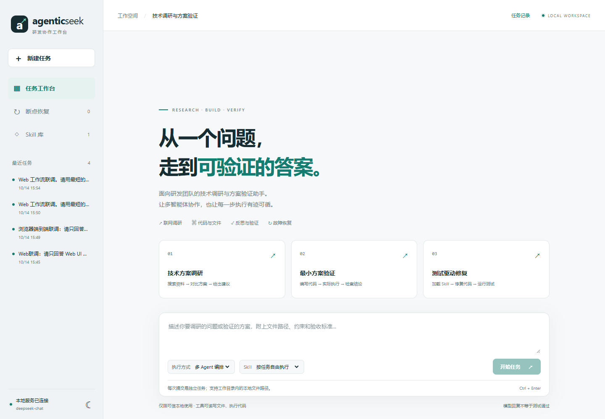
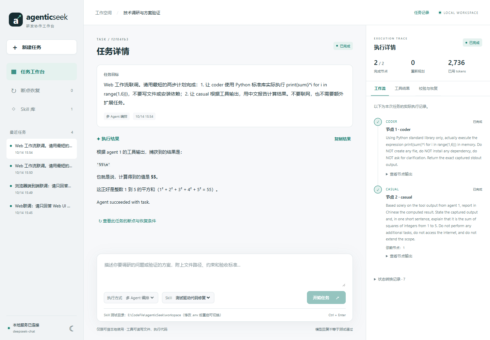

# Technology Assessment & Validation System (TAVS)

**Technology Assessment & Validation System (TAVS)** is a multi-agent assistant for R&D teams. It turns a technical question into a traceable workflow for technology research, solution comparison, prototype execution, and evidence-based validation.



## What it does

TAVS combines:

- Web research through SearXNG and a browser agent;
- task routing, planning, and specialized child agents;
- file analysis and isolated Python/PowerShell execution;
- reflection and evaluation of intermediate and final answers;
- Skill loading for reusable, policy-constrained capabilities;
- a React Web console for task submission, execution traces, evidence, and recovery.

The original AgenticSeek project provided a general-purpose local assistant with web browsing, coding, file processing, voice features, and multi-agent task execution. TAVS keeps the reusable agent and tool foundation while focusing it on technical assessment and solution validation.

## Reliability improvements

The main contribution of this version is turning a prompt-driven workflow into a recoverable execution system:

1. **Explicit workflow state machine** — task dependencies, state transitions, retry limits, replanning, and terminal conditions are managed in code.
2. **Unified failure recovery** — timeout, rate limiting, empty results, invalid parameters, missing files, execution errors, and model failures are classified into retryable and non-retryable cases.
3. **Checkpoint persistence** — completed steps, pending steps, tool outputs, errors, token usage, and execution history are saved so an interrupted task can resume without repeating successful work.
4. **Reflection and evaluation loop** — an initial answer is reviewed, repaired when necessary, and verified against structured criteria instead of trusting a single model score.
5. **Skill mechanism** — skills are registered, loaded on demand, validated, and connected to the workflow with checkpoint metadata.
6. **Evidence-first Web UI** — users can inspect the execution trace, tool outputs, validation records, and recovery checkpoints.



## Repository structure

```text
sources/       Agents, workflow state machine, recovery, tools, Web runtime
prompts/       Planner and specialist-agent prompts
skills/        Example Skill and Skill policy resources
frontend/      React Web console
tests/         Unit, workflow, recovery, Web, and Skill tests
benchmarks/    Datasets, experiment runners, and scoring reports
searxng/       Search service configuration
scripts/       Local installation and smoke-test scripts
docs/          Architecture, contribution, security, and screenshots
```

## Quick start

```powershell
Copy-Item .env.example .env
Copy-Item config.example.ini config.ini
# Set WORK_DIR and the model API key you choose in .env
docker compose --profile core up -d redis searxng
.\start_web.ps1 -SkipBuild -Background
```

Open `http://127.0.0.1:7777`. The Web service is intentionally bound to localhost. See [WEB_GUIDE.md](./WEB_GUIDE.md) for API and troubleshooting details.

## Testing

```powershell
.\.venv\Scripts\python.exe -m unittest discover -s tests -p "test_web*.py" -q
.\.venv\Scripts\python.exe -m unittest discover -s tests -p "test_*recovery*.py" -q
```

Live model tests may consume API credits. Search and model credentials belong only in `.env`; never commit them.

## Attribution and license

This project is a derivative work based on [AgenticSeek](https://github.com/Fosowl/agenticSeek), licensed under the GNU General Public License v3.0. This version adds the reliability-focused workflow, recovery, reflection/evaluation, Skill support, and Web execution interface. See [LICENSE](./LICENSE), [the open-source guide](./docs/OPEN_SOURCE_GUIDE.md), and [SECURITY.md](./SECURITY.md).
